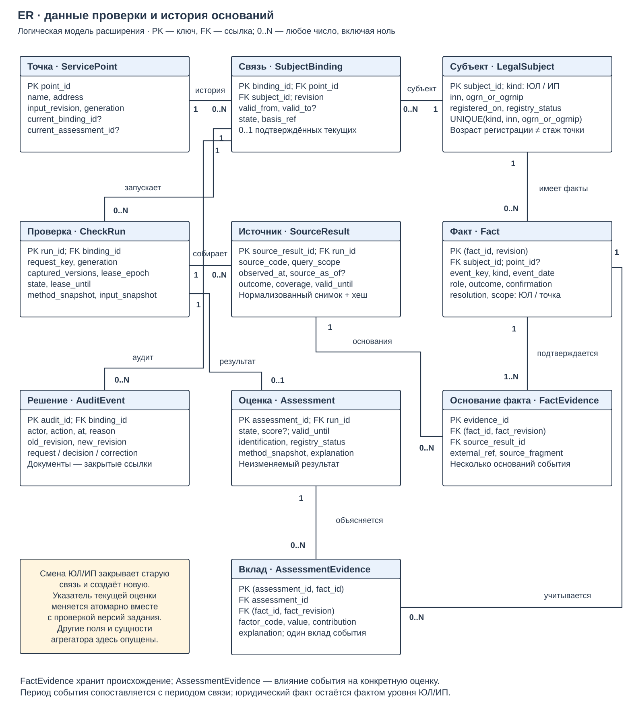
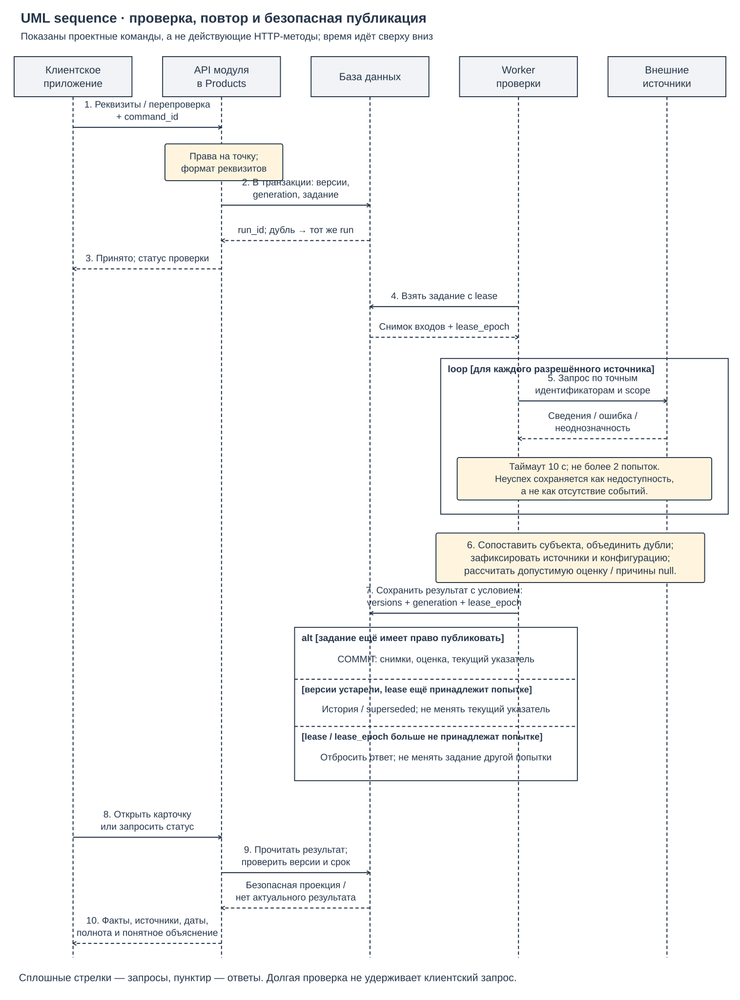
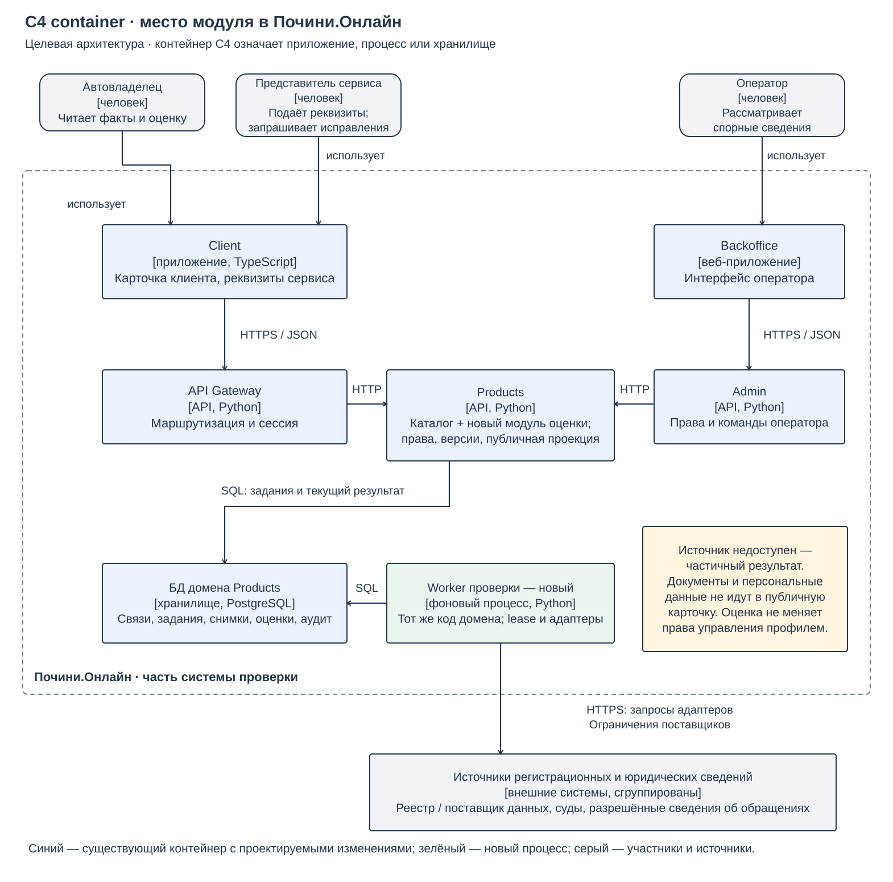
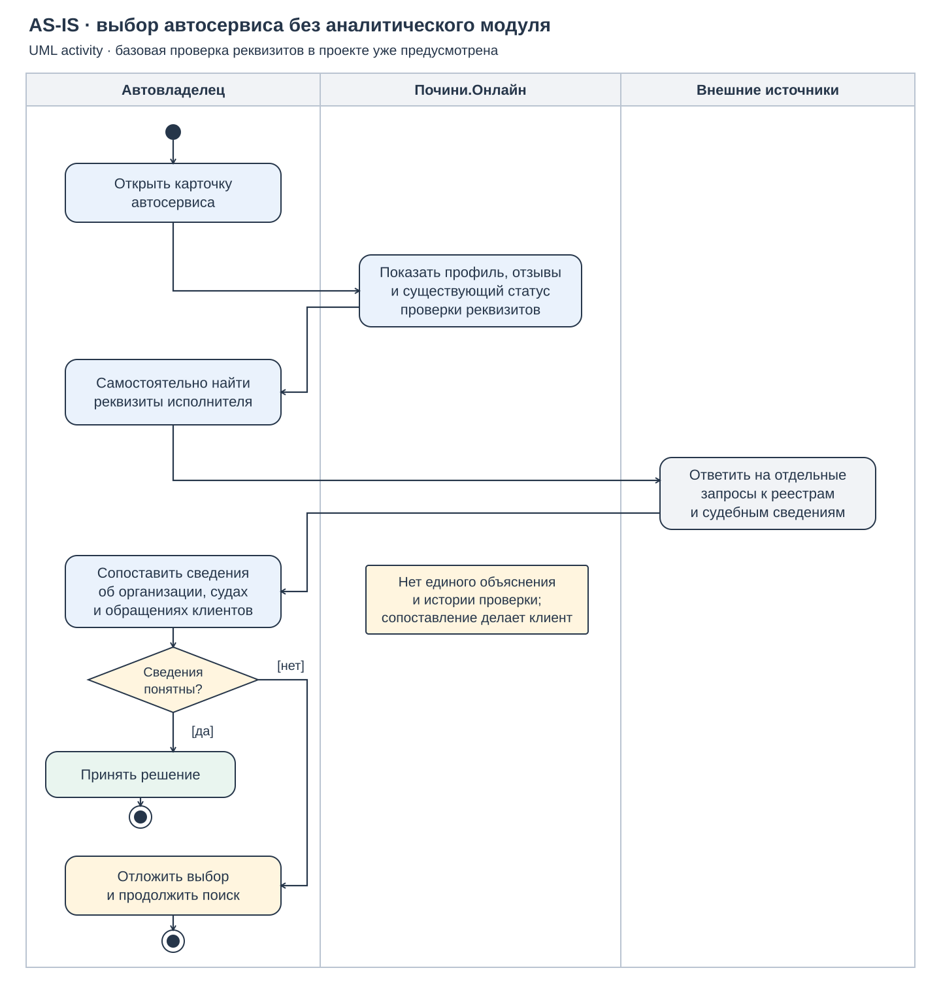
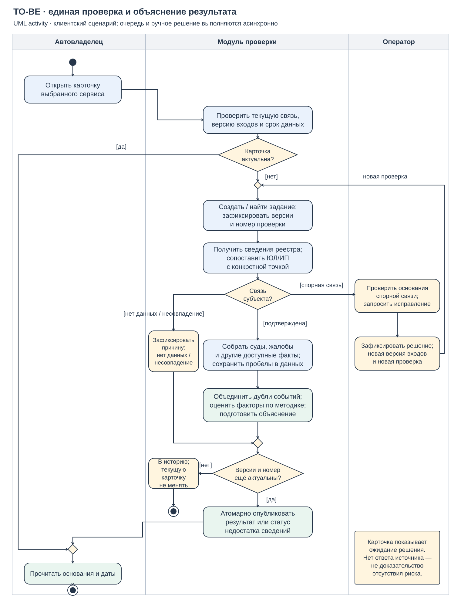

# Лабораторная работа № 3. Проектирование информационной системы

**Тема ВКР:** «Аналитика и разработка автоматической верификации автосервисов и оценки их надежности в системе-агрегаторе для автосервисов, механиков и автовладельцев».

**Автор:** Панин Дмитрий Владимирович, группа K3420.

**Дисциплина:** проектный семинар. Семестр 7. Работа выполнена индивидуально.

**Дата:** 30 октября 2026 года.

В [лабораторной работе № 2](https://github.com/bananichdev/vkr-autoservice-verification/blob/23b34ee95c2deb6d0b8cf4f677f46964e81bf809/docs/research/report.md) я рассмотрел источники данных и похожие решения. В этой работе перехожу к проектированию: определяю, что должен делать модуль, какие данные ему нужны и как он будет работать внутри Почини.Онлайн.

## 1. Предметная область и требования

### 1.1. Какую задачу решает модуль

Перед обращением в автосервис клиенту важно понять, кто принимает обязательства по ремонту и гарантии. Название на вывеске, профиль в агрегаторе и юридическое наименование могут различаться. Кроме того, одна организация может управлять несколькими мастерскими, а у одной мастерской со временем может смениться юридическое лицо.

Поэтому разделяю две задачи. **Верификация** устанавливает ЮЛ или ИП, связанное с выбранной точкой обслуживания, и проверяет регистрационные сведения. **Оценка надёжности для клиента** объясняет доступные факты об этом исполнителе: возраст бизнеса, судебную историю, жалобы, банкротство и взыскания. Основания и ограничения должны быть видны рядом с результатом.

В исходном проекте уже предусмотрены проверка пары ИНН и ОГРН/ОГРНИП через реестровый клиент, отдельная проверка полномочий пользователя и правила публикации профиля. Новый модуль развивает работу с юридическими сведениями. Получение оценки не даёт пользователю прав управлять сервисом. Рассматриваемое текущее состояние основано на ЛР2 и анализе проектных файлов; промышленная эксплуатация в этой работе не проверялась.

Участники процесса:

- **Автовладелец** читает карточку и принимает решение об обращении.
- **Представитель сервиса** подаёт реквизиты своей точки, запрашивает перепроверку и исправление сведений в пределах имеющихся прав.
- **Оператор** рассматривает неоднозначную связь, проверяет основания исправления и фиксирует решение.
- **Модуль и фоновый обработчик** собирают сведения, сохраняют их происхождение и готовят объяснимый результат.

Внешние источники рассматриваются как поставщики сведений с разными условиями доступа и полнотой. Доступность автоматического получения данных из всех перечисленных в ЛР2 ресурсов ещё предстоит проверить. Для первого прототипа подойдут разрешённые снимки и синтетические случаи.

### 1.2. Функциональные требования

| ID | Что должна делать система | Как проверить |
|---|---|---|
| FR-01 | Принимать реквизиты ЮЛ/ИП для конкретной точки от представителя с правом на эту операцию и проверять их формат. | Корректная пара идентификаторов принимается; ошибка формата возвращается до внешнего запроса; изменение чужой точки отклоняется. |
| FR-02 | Сопоставлять реквизиты с реестром, отдельно показывая результат идентификации и регистрационный статус. | Проверить точное совпадение, несовпадение, недоступный источник и неоднозначную связь. «Не удалось проверить» не превращается в подтверждение. |
| FR-03 | Хранить историю связи точки с ЮЛ/ИП и различать возраст регистрации, стаж бренда и историю конкретной мастерской. | После смены субъекта старая связь закрыта. Её судебные события и возраст не переносятся новой организации как её собственные. |
| FR-04 | Собирать доступные факты о судах, обращениях, банкротстве и взысканиях с указанием источника, периода и области действия. | У дела сохранены роль, стадия и известный результат. У жалобы отдельно отражены подтверждённость и урегулирование. Неизвестное значение остаётся неизвестным. |
| FR-05 | Объединять сведения об одном событии и формировать объяснимую оценку факторов по зафиксированной версии правил. | Два источника одного дела дают одно событие и один вклад. Противоречие без надёжного разрешения помечается для проверки, а не устраняется произвольным выбором. |
| FR-06 | Показывать клиенту результат верификации, факторы внимания, основания, даты и недостающие сведения. | По карточке можно установить, какое ЮЛ/ИП проверено, что обнаружено и что не проверено. Поступившая жалоба и участие в суде не названы доказанным нарушением. |
| FR-07 | Выполнять первичную и повторную проверку в фоне, позволяя запросить её вручную или по расписанию. | Клиент получает статус задания без ожидания всех источников. Повтор одной команды возвращает то же задание, новый период проверки создаёт новое. |
| FR-08 | Публиковать результат только для актуальной связи, версии входных сведений и номера проверки. | Задержанный ответ старой проверки не заменяет новый результат, в том числе после смены ЮЛ/ИП или исправления жалобы. |
| FR-09 | Поддерживать запрос исправления и ручное рассмотрение с причиной, автором решения и историей изменений. | Представитель подаёт запрос; решение принимает оператор с нужными правами. Старый снимок сохраняется, исправление создаёт новую версию и перепроверку. |
| FR-10 | Различать полные в рамках запроса, частичные, противоречивые и устаревшие сведения. | При отказе одного источника сохраняются доступные факты и причина пробела. По истечении срока карточка теряет отметку актуальности; отсутствие ответа не улучшает оценку. |

### 1.3. Нефункциональные требования

Это проектные ограничения для будущего прототипа. Измерения и испытания по ним в ЛР3 не проводились.

| ID | Требование | Условия проверки после реализации |
|---|---|---|
| NFR-01 | Результат должен быть воспроизводим: у каждого использованного факта есть основание, две даты при их доступности, область поиска и версия правил. | Для каждого результата проверочного набора восстановить использованные снимки и конфигурацию. Повтор расчёта на них даёт тот же результат. |
| NFR-02 | Права проверяются на сервере. Публичная карточка содержит только разрешённую проекцию, без документов, контактов заявителя и внутренних комментариев. | Запросы клиента и представителя чужой точки не позволяют изменить сведения или получить закрытые основания; оператор действует только в рамках своей роли. |
| NFR-03 | Отказ внешнего источника не должен блокировать карточку. Для одного обращения к источнику — таймаут 10 секунд и максимум две попытки; общий бюджет задания — 120 секунд. | Имитировать зависание и ошибку ответа. Незавершённые обращения после общего срока отменяются, их результат — «источник недоступен», а карточка читается из сохранённых данных. |
| NFR-04 | Для первого прототипа срок свежести реестровой проверки — 24 часа, остальных результатов источников — до 7 суток. Смена реквизитов или исправление входных фактов немедленно снимает актуальность старой оценки. | Управляемо сдвинуть время и изменить входную версию. Проверить отметку устаревания и постановку перепроверки. Более старую дату самих исходных сведений нельзя скрывать новой датой загрузки. |
| NFR-05 | Повтор команды и одновременная работа обработчиков не должны создавать несколько актуальных результатов или позволять старой попытке перезаписать новую. | Повторить одну команду, завершить два задания в обратном порядке и возобновить обработчик после утраты права на задание. Текущий результат остаётся единственным и правильной версии. |
| NFR-06 | Чтение готовой карточки не вызывает внешние источники; целевой p95 ответа — не более 1 секунды. | На наборе из 1000 сохранённых карточек выполнить 1000 запросов при 20 одновременно работающих клиентах в зафиксированном тестовом окружении; измерить 95-й процентиль. |

Сроки свежести и бюджет запросов выбраны как начальные настройки прототипа. Их нужно уточнить по условиям поставщиков и результатам испытаний. Понятие «актуально» относится к конкретным данным и периоду проверки, а не означает, что системе известны все события о компании.

## 2. Обзор нотаций и видов диаграмм

В таблице восемь позиций из перечня задания. Отдельные виды UML рассматриваются отдельно, поскольку отвечают на разные вопросы.

| Нотация или вид | Что описывает | Чем полезна для проектирования |
|---|---|---|
| BPMN | Бизнес-процесс, участников, события и обмен сообщениями. | Удобна для подробного согласования процесса с бизнесом и оператором. [Описание OMG](https://www.omg.org/spec/BPMN/2.0.2). |
| IDEF0 | Функции системы, входы, выходы, управляющие воздействия и механизмы. | Помогает определить границы и разложить большую функцию на части. [Документ NIST FIPS 183](https://www.govinfo.gov/app/details/GOVPUB-C13-ba43579ec72306f00c01305771ffdf3b). |
| ER-модель | Сущности, атрибуты, отношения и их кратности. | Позволяет проверить структуру данных и отделить юридический субъект от точки обслуживания. [Работа P. Chen](https://doi.org/10.1145/320434.320440). |
| DFD | Преобразования данных, хранилища, внешние сущности и потоки. | Показывает, откуда приходят сведения и куда они попадают после обработки. [Описание IBM](https://www.ibm.com/think/topics/data-flow-diagram). |
| UML use case | Варианты использования и цели участников. | Помогает очертить функции и роли без подробностей реализации. [Спецификация UML](https://www.omg.org/spec/UML/2.5.1). |
| UML activity | Действия, условия, ветвления и распределение ответственности. | Удобна для сравнения текущего и целевого процесса, включая нехватку данных и ручную проверку. [UML](https://www.omg.org/spec/UML/2.5.1). |
| UML sequence | Сообщения между участниками во времени. | Позволяет проверить очередь, повторные запросы, ответы источников и момент публикации. [UML](https://www.omg.org/spec/UML/2.5.1). |
| C4 container | Приложения и хранилища внутри системы, их обязанности и связи. | Объясняет место нового модуля в существующем агрегаторе. Контейнер здесь — приложение, процесс или хранилище; речь не обязательно о Docker. [Описание C4](https://c4model.com/diagrams/container). |

## 3. Выбор нотаций для проекта

Выбираю четыре вида моделей. Вместе они позволяют проверить процесс, данные, порядок взаимодействий и распределение ответственности.

| Выбранный вид | Что моделирую | Требования | Почему подходит |
|---|---|---|---|
| UML activity | AS-IS и TO-BE выбора сервиса и подготовки результата. | FR-02, FR-04–10; NFR-03–05. | На одной схеме видны автоматический путь, неопределённость и передача оператору. Ту же нотацию удобно использовать для сравнения состояний. |
| ER | Точку, ЮЛ/ИП, историю связи, снимки источников, факты и оценки. | FR-01–05, FR-08–10; NFR-01, NFR-04–05. | Структура не позволяет незаметно смешать разные организации или потерять происхождение факта. |
| UML sequence | Постановку задания, запросы к источникам и условную публикацию. | FR-01–02, FR-05–08, FR-10; NFR-01–06. | Поздний ответ и повторный запуск можно показать как конкретный порядок событий. |
| C4 container | Связи интерфейсов, API, домена, обработчика и БД. | FR-01, FR-04, FR-06–09; NFR-02–03, NFR-06. | Видно, где проверяются права, где хранятся сведения и почему клиент не ждёт внешние реестры. |

Бизнес-логику раскрывает activity, структуру БД — ER, взаимодействия и потоки — sequence вместе с C4. BPMN также подошла бы для процесса, но в пределах этой работы activity позволяет показать нужные ветвления достаточно компактно. Дополнительная модель тех же действий здесь мало что добавит.

## 4. Модели системы

### 4.1. Структура данных — ER

На рисунке показана логическая модель расширения. Это проект данных для будущего прототипа, а не описание уже созданных таблиц. Обозначение `0..N` допускает любое число записей, включая отсутствие, `0..1` — не более одной. У каждой дочерней записи есть указанный на схеме родитель; необязательность отдельной ссылки помечена знаком `?`.

**Точка и субъект.** `ServicePoint` представляет конкретную мастерскую, `LegalSubject` — ЮЛ или ИП. В `SubjectBinding` хранится основание их связи и период её действия. У точки может ещё не быть подтверждённого субъекта; одновременно действует не более одной подтверждённой связи. Филиалы одной организации используют тот же субъект, но сохраняют собственную историю обслуживания. При смене организации старая связь закрывается. Дата регистрации относится к ЮЛ/ИП; стаж бренда или точки требует отдельного подтверждения.

**Источники и события.** `SourceResult` сохраняет результат конкретного запроса: что искали, за какой период, когда получили ответ и какая дата актуальности указана самим источником. `Fact` — версия канонического события, а `FactEvidence` связывает её с несколькими подтверждениями. Например, два ответа об одном деле с тем же номером и участником не создают два судебных события. Канонический `fact_id` остаётся одним, исправление меняет `revision`. Похожего текста для объединения недостаточно. Спорные совпадения остаются на рассмотрении.

Факт содержит область действия: юридический субъект или определённая точка. Событие сопоставляется с периодом связи, при этом проверка нового исполнителя может учитывать его более раннюю историю именно как историю этого ЮЛ/ИП. Суды прежней организации не становятся судами новой, а судебное дело всей компании не объявляется доказательством плохого ремонта в каждом филиале.

**Результат и объяснение.** `CheckRun` фиксирует входные версии и конфигурацию правил. `Assessment` хранит неизменяемый результат, `AssessmentEvidence` — выбранную версию факта и объяснение её влияния. Первичный ключ пары «оценка — канонический факт» допускает одну его версию и не даёт добавить событие в результат дважды. Промежуточные показатели по факторам можно собрать в объяснении. Указатели текущей связи и оценки принадлежат точке, но исторические записи сохраняются.

`AuditEvent` хранит запрос, решение или исправление с автором и причиной. Файлы оснований доступны по закрытым ссылкам. Публичное объяснение не должно содержать эти документы или персональные сведения заявителей.

Для согласованности модели нужны ограничения:

1. Идентификаторы ЮЛ/ИП образуют уникальную нормализованную запись; у точки нет пересекающихся периодов подтверждённых текущих связей.
2. Использованные снимки, версии фактов и конфигурация методики после расчёта не переписываются. Исправление создаёт новую версию.
3. Один канонический факт относится к одному субъекту; если указан `point_id`, принадлежность точки проверяется по исторической связи. В `AssessmentEvidence` допускаются только факты проверяемого субъекта и подходящей области.
4. Указатель текущей оценки меняется только после проверки входных версий и права задания на публикацию. Чтение повторно проверяет их и срок свежести.

Так ER отражает FR-01–05, FR-08–10 и NFR-01, NFR-04–05. Модель позволяет восстановить объяснение и не требует перезаписывать историю при смене исполнителя.

### 4.2. Взаимодействие при проверке — UML sequence

Диаграмма показывает один типовой запуск. Представитель отправляет реквизиты или запрос перепроверки, сервер проверяет его права и формат данных. В одной транзакции фиксируются входные версии и создаётся задание. Приложение получает его идентификатор сразу. Проверка по расписанию использует ту же очередь, но запускается системным планировщиком в домене.

Фоновый обработчик получает задание на ограниченное время — это **lease**. После зависания другой обработчик сможет продолжить работу. Внешние запросы ограничены таймаутом, числом попыток и общим бюджетом. Для источников, к которым ещё нет разрешённой интеграции, сохраняется причина недоступности. Чтение карточки выполняется отдельно и не вызывает сбор заново в рамках того же HTTP-запроса.

Перед публикацией проверяются разные причины устаревания:

| Что сохраняется у задания | Какую проблему предотвращает |
|---|---|
| `command_id` / `request_key` | Повтор одной пользовательской команды не создаёт вторую проверку. Для той же команды с другим содержимым сервер возвращает конфликт. |
| Версии связи, входов и методики | Проверка старого ЮЛ/ИП или уже исправленных сведений не становится текущей. |
| `generation` — номер актуальной проверки | Более раннее обновление не перезаписывает более позднее даже при одинаковых входных реквизитах. Новый запрос по расписанию получает новый номер. |
| `lease_epoch` — номер попытки обработки | Обработчик, потерявший lease, не публикует результат после своего возобновления. |

Сохранение оценки и смена текущего указателя выполняются атомарно. Условие включает текущие версии, `generation`, действующий lease и его `lease_epoch`. Старый результат можно оставить в истории, но использовать его как новый нельзя. Потерявшая lease попытка не меняет и состояние задания, которым уже владеет другая попытка.

Пока идёт обновление, предыдущую карточку можно показывать с её собственной датой, если входные версии прежние и срок данных не истёк. После смены реквизитов или подтверждённого исправления она сразу перестаёт считаться текущей. Вместо неё клиент видит статус новой проверки и доступные безопасные сведения.

Эта модель раскрывает FR-01–02, FR-05–08, FR-10 и NFR-01–06. Условия в таблице — проектные правила, которые затем проверяются сценариями с повтором, задержкой и обратным порядком завершения заданий.

### 4.3. Архитектура — C4 container

Новый модуль располагается в домене `Products`, который уже работает с профилями и реквизитами автосервисов. Отдельный сервис для расчёта на этом этапе не требуется. Фоновый worker выделен как процесс с тем же доменным кодом: он выполняет длительные обращения и не задерживает клиентский API.

В прототипе задания хранятся в БД домена. Создание задания вместе с фиксацией версий выполняется транзакционно, обработчик забирает его с lease. Это даёт один понятный источник состояния проверки. На рисунке показана относящаяся к задаче часть агрегатора, а не вся его инфраструктура.

Клиентские операции проходят через `API Gateway` к `Products`, операторские — через `Backoffice` и `Admin`. Проверка сессии на шлюзе дополняется проверкой права на конкретную операцию и точку в домене. Скрытие кнопки в интерфейсе не заменяет эту проверку.

Адаптеры источников находятся в коде обработчика. Каждый переводит ответ в общий формат снимка и сохраняет границы его использования. Системы реестров и юридических сведений сгруппированы на рисунке; наличие публичного сайта не означает готового API. Для каждого будущего адаптера отдельно проверяются условия доступа и ограничения поставщика.

Клиент получает из сохранённой оценки только разрешённую проекцию. Публикация карточки сервиса, право управлять им и доступ к внутренним основаниям проверяются независимо. В том числе сведения об ИП нельзя автоматически раскрывать целиком лишь потому, что они встретились в источнике.

C4 связывает FR-01, FR-04, FR-06–09 с владельцами операций. Разделение API и worker поддерживает NFR-03 и NFR-06, а серверные проверки и безопасная проекция — NFR-02. Выполнение целевого времени ответа ещё нужно измерить после реализации: сама диаграмма его не доказывает.

### 4.4. Как интерпретируются факты и состояния

Для первого прототипа выбираю прозрачный профиль факторов **R1**. Он показывает проверенные сведения, признаки, требующие внимания, и пробелы. Правила и границы периода входят в неизменяемую конфигурацию. Возраст бизнеса отображается как дата и срок с указанием, к какому субъекту он относится. Молодая организация автоматически ненадёжной не объявляется.

| Ситуация | Результат правила R1 |
|---|---|
| ЮЛ/ИП и связь с точкой однозначно установлены | Можно относить проверяемые факты этого субъекта к профилю, сохраняя их область действия. Регистрационный статус показывается отдельно. |
| Известно только похожее название, связь спорная или реестр недоступен | Не присваивать точке чужую судебную историю; показать причину и необходимость уточнения. |
| Найдено судебное дело | Показать роль, предмет, стадию и исход, если они известны. Сам факт участия не становится отрицательным выводом. Основание внимания — конкретный подтверждённый результат, относящийся к обязательствам исполнителя перед клиентами. Неясная интерпретация требует оператора. |
| Поступила жалоба | До проверки показать только допустимый статус обращения. Подтверждение и урегулирование хранятся отдельно: подтверждённая жалоба может быть уже урегулирована. Число обращений не превращается в долю без известного числа заказов и периода. |
| Подтверждено актуальное банкротство или взыскание | Отразить именно этот финансовый факт и источник. Он не называется прямым измерением качества ремонта. |
| Источники сообщают разное | Сопоставить первичность и дату актуальности. Неразрешённое противоречие обозначить явно; большинство одинаковых перепечаток не считается доказательством. |
| Запрос завершён и записей не найдено | Указать источник, запрос и охваченный период. Формулировка относится к этому поиску, а не ко всем возможным жалобам и судам. |

В R1 числовой балл не публикуется: поле `score` имеет значение `null`, а пользователь получает объяснимый профиль. Это конкретный формат первого прототипа. Для балльных вариантов из плана ЛР2 предусмотрено сохранение версии методики и вкладов факторов. Их веса, минимальный охват и пороги нужно определить и проверить на подготовительной части набора до использования на независимых организациях. Число не должно выдаваться за вероятность качественного ремонта.

При R1 положительный результат идентификации не равен положительной оценке обслуживания. Если связь не подтверждена, противоречия существенны или обязательные для методики сведения отсутствуют, общий вывод — «недостаточно данных», даже если отдельные доступные факты сохранены. Необходимый минимум для привязки профиля факторов — однозначная связь точки с субъектом и актуальный результат реестровой проверки. Точная пара идентификаторов устанавливает запись в реестре; основание связи с мастерской должно быть подтверждено существующим процессом либо документально оператором. Само право редактировать профиль этого не доказывает. Все дополнительные факторы имеют собственные признаки полноты и давности.

Состояния также разделены:

- **Идентификация:** субъект установлен, найдено несовпадение, нужно рассмотрение либо проверка недоступна. Статус реестра — например, действующий или прекративший деятельность — хранится отдельно. Установить субъект можно и для записи о прекратившем деятельность исполнителе; это не разрешает назвать его действующим.
- **Источники и оценка:** полные в описанных границах, частичные или недостаточные сведения. Устаревание проверяется по датам отдельно.
- **Задание:** ожидает, выполняется, завершено, частично завершено, требует рассмотрения, не выполнено из-за внутреннего сбоя либо заменено новой проверкой. Завершение задания не означает успешной верификации.

Если одновременно найдены неоднозначность связи и недоступность источника, итог задания — «требует рассмотрения», а недоступность остаётся в результатах источников. Если проверки завершены однозначно, но часть источников недоступна, итог — «частично завершено». Внутренняя ошибка означает отдельный неуспех, а утрата актуальности — заменённую проверку. После ручного решения запускается новое задание; старый результат не переписывается.

## 5. AS-IS и TO-BE

### 5.1. AS-IS — текущее состояние без предлагаемого модуля

Клиент открывает профиль, видит отзывы и предусмотренный проектом базовый статус проверки. Если ему нужны сведения о юридическом исполнителе и рисках, приходится отдельно искать реквизиты, обращаться к разным источникам и самостоятельно сопоставлять результаты. Нет единого объяснения, какой период проверен и можно ли связать найденное дело с выбранной мастерской. При недостатке понятных сведений выбор откладывается.

AS-IS описывает этот клиентский процесс. Он сохраняет уже имеющуюся проверку реквизитов и не предполагает, что раньше в проекте совсем не было верификации.

### 5.2. TO-BE — процесс с модулем

Карточка сначала проверяется на актуальность. Если данных достаточно и они свежие, клиент читает готовый результат. Иначе запускается фоновая проверка. Модуль устанавливает юридический субъект и связь с точкой, собирает доступные факты, объединяет дубли и формирует объяснение по R1.

При несовпадении или недоступности сохраняется конкретная причина. Спорная связь передаётся оператору. Ручное рассмотрение может ожидать уточнения; этот статус виден в карточке. После решения меняется входная версия и создаётся новая проверка. Путь через оператора на схеме показывает именно этот повторный запуск.

Оба автоматических исхода — профиль факторов или статус недостатка данных — проходят проверку актуальности перед публикацией. Устаревшее задание остаётся в истории. Клиентский интерфейс получает сохранённый результат отдельным запросом; схема activity описывает весь процесс, а не ожидание одного сетевого соединения.

### 5.3. Что обеспечивает переход

| Ограничение AS-IS | Решение TO-BE и место на схеме | Что становится лучше |
|---|---|---|
| Клиент сам связывает название с организацией. | «Получить сведения реестра; сопоставить ЮЛ/ИП» и ветка оператора. | Результат относится к явно указанному исполнителю; неопределённость видна. |
| Сведения ищутся и читаются раздельно. | «Собрать … факты» и «объединить дубли событий». | Один спор не учитывается несколько раз, основания сохраняются вместе. |
| Неясно, что означает отсутствие результата. | Ветка «нет данных / несовпадение» и причины пробелов. | Нехватка сведений не выглядит как отсутствие проблем. |
| Найденные сведения могут относиться к другой дате или организации. | Проверка версий и номера задания перед публикацией; исторические связи в ER. | Поздний ответ не подменяет актуальный результат. |
| Клиенту приходится самостоятельно формулировать вывод. | Последнее действие «прочитать основания и даты». | Он получает объяснение по конкретным факторам и видит пределы проверки. |

Диаграммы демонстрируют ожидаемое изменение процесса. Сокращение времени выбора и понятность карточки предстоит проверить на прототипе, а не выводить только из наличия модели.

## 6. Согласованность моделей и выводы

### 6.1. Где отражены требования

| Требования | Элементы моделей | Основной проверочный случай |
|---|---|---|
| FR-01, FR-02 | Sequence: проверка прав и реквизитов; ER: субъект и связь; TO-BE: сопоставление. | Корректная пара, ошибочная пара, чужая точка и отказ реестра дают разные результаты. |
| FR-03 | ER: точка, субъект, период связи и область факта. | Смена ЮЛ/ИП и два филиала одной компании не смешивают историю. |
| FR-04, FR-05 | ER: SourceResult, FactEvidence, Fact, AssessmentEvidence; TO-BE: сбор и объединение событий. | Два источника одного дела, противоречие и урегулированная жалоба. |
| FR-06 | C4: публичная проекция Products; TO-BE: чтение оснований; Assessment: объяснение R1. | Клиент различает установленный факт, дату и непроверенное сведение. |
| FR-07, FR-08 | C4: worker и задания в БД; sequence: command_id, версии, generation, lease_epoch и условный COMMIT. | Повтор команды, зависший обработчик и обратный порядок ответов. |
| FR-09 | TO-BE: оператор и новый запуск; ER: AuditEvent и неизменяемые версии. | Исправление с основанием сохраняет старую историю и снимает актуальность прежней оценки. |
| FR-10 | TO-BE: отдельные исходы; SourceResult: полнота и время; sequence: чтение с проверкой срока. | Источник не ответил либо данные устарели. |
| NFR-01 | Снимки, FactEvidence, конфигурация в CheckRun/Assessment и выбранные основания оценки. | Повтор расчёта по сохранённым входам воспроизводит объяснение. |
| NFR-02 | C4: серверные границы и безопасная проекция; sequence: проверка прав; ER: закрытые основания. | Чужой представитель и обычный клиент не получают документы или право исправления. |
| NFR-03 | Sequence: ограниченный цикл запросов; C4: worker; TO-BE: неполный результат. | Зависание поставщика не блокирует чтение карточки. |
| NFR-04 | SourceResult и Assessment: даты; TO-BE: актуальность; sequence: проверка перед чтением. | Истечение 24 часов / 7 суток и немедленная смена входов. |
| NFR-05 | CheckRun и текущий указатель; sequence: атомарная проверка версий и lease. | Один актуальный результат после конкурирующих попыток. |
| NFR-06 | C4: сохранённая оценка; sequence: отдельный быстрый путь чтения. | Нагрузочное измерение готовых карточек в условиях из NFR-06. |

### 6.2. Выводы

Выбранные четыре вида моделей отвечают на разные вопросы. Activity показывает, как меняется работа клиента и оператора. ER помогает правильно разделить точку, юридического исполнителя и историю сведений. Sequence раскрывает порядок обработки и защищает от поздних ответов. C4 показывает место решения в агрегаторе и распределение ответственности.

Модели согласованы через одни и те же объекты: связь точки с субъектом, задание проверки, снимки источников, факты и объяснение оценки. Требования отражены конкретными элементами и проверочными случаями. Это позволяет перейти к реализации и испытаниям, хотя само наличие диаграмм ещё не подтверждает достижение требований по времени ответа или качеству оценки.

Главное изменение TO-BE — клиенту доступен единый результат с основаниями и границами проверки. При этом не смешиваются регистрация и качество ремонта, судебное участие и установленное нарушение, поступление жалобы и её подтверждение. Этап проектирования также показал, что для достоверного объяснения нужны история связи, происхождение фактов и контроль версий, а не только итоговая отметка в профиле.

Дальше потребуется проверить доступность источников, реализовать прототип и выполнить сценарии из таблиц. Балльные варианты оценки будут сравниваться по плану ЛР2 на подготовленном наборе организаций. В этой работе получена проектная основа для такого сравнения.

**Материалы:** рисунки находятся в [assets/design](../../assets/design/), их воспроизводимый [исходник](../../assets/design/generate_diagrams.py) использует только стандартную библиотеку Python. SVG можно открыть отдельно в полном размере. Структура отчёта сверена с [условиями ЛР3](https://docs.google.com/document/d/1eUcNd1wMwoVaSu-DSS-cVRgLJvTT6vza/edit) и [порядком сдачи](../../course/lab3.md).
